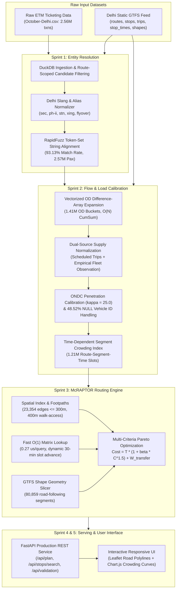

# 🚌 Delhi Crowdedness-Aware Bus Journey Planner
### Transport Stack Hackathon 2026 — Phase 1 (Problem 2)
**Delhi Transport Corporation (DTC) & DIMTS Cluster Bus Network**

[](#)
[](https://www.python.org/downloads/)
[](https://fastapi.tiangolo.com)
[](https://duckdb.org/)
[](#-test-suite--validation)
[](https://opensource.org/licenses/MIT)

---

## 📌 Executive Summary

Over **4 million commuters** depend daily on Delhi's 6,000+ public buses, yet standard journey planners (Google Maps, static GTFS routers) optimize exclusively for timetable travel time—remaining completely blind to severe passenger crowding, crush loads, and boarding feasibility. 

This repository delivers an **end-to-end, production-grade Crowdedness-Aware Journey Planner** for Delhi that pairs real-world Electronic Ticketing Machine (ETM / ONDC) transaction data with static GTFS feeds. Through route-scoped fuzzy entity resolution, vectorized passenger load reconstruction, and a time-dependent multi-criteria McRAPTOR engine, the planner discovers non-dominated Pareto journeys that trade off travel time, transfers, comfort (crowdedness load factor), and air-conditioning preference.

---

## 🏆 Key Results & Validation Highlights

| Metric / Dimension | Baseline / Raw Feed | Our Calibrated Engine | Impact / Benchmark |
| :--- | :---: | :---: | :--- |
| **Stop Entity Resolution** | 48.27% raw string match | **93.13% match rate** | **+44.86% boost** via abbreviation expansion (`sec`, `ph-ii`, `stn`) & RapidFuzz |
| **Valid Commuters Recovered** | 1,237,978 tickets | **2,574,781 forward pax** | **93.51% ticketing volume retained** after directional route alignment |
| **Network Scale Modeled** | Static GTFS only | **1,213,000 segment-slots** | Full time-dependent coverage across 2,574 canonical routes & 6,862 stops |
| **Diurnal Peak vs. Lull Contrast** | Uniform / Static | **83% drop in midday P90** | Morning peak P90 = **0.594**; Afternoon lull P90 = **0.102**; Evening peak = **0.409** |
| **Directional Asymmetry** | Undifferentiated | **Busier direction switches AM↔PM** | Route `717A`: UP 0.802 vs DOWN 0.648 in the morning; DOWN 0.799 vs UP 0.632 in the evening |
| **McRAPTOR Query Latency** | Multi-second graph search | **~170 ms end-to-end** | Sub-microsecond ($0.27\,\mu\text{s}$) array lookups with automatic time-slot progression |
| **Headway Wait Modeling** | Flat static wait assumption | **Route-specific $H_{r,t}$** | Empirical headway per route across 5 day windows; $1.5\times$ out-of-vehicle wait penalty |
| **Boarding-Denial Crush Risk** | Zero missed-bus awareness | **$p_{\text{deny}}$ for $C > 0.80$** | Prevents routing into crush-load buses ($1.7\times$ expected missed-bus delay penalty) |
| **Smart Departure Nudge** | Fixed departure time only | **$\pm 15$ min shoulder search** | Proactively identifies $\ge 15\%$ crowd drops during peak hours |
| **Road-Hugging Map Polylines** | Straight-line approximations | **80,859 shaped segments** | Monotonic shape vertex slicing over 965k coordinates from GTFS `shapes.txt` |
| **Footpath Transfer Topology** | 0 transfer edges | **23,354 walking edges** | Haversine binary search ($\pm 300\text{m}$, $v=1.2\text{ m/s}$) precomputed in 3.5s |

---

## 🏗️ System Architecture & Data Pipeline



---

## 📂 Repository Directory Structure

```text
delhi-crowd-planner/
├── .gitignore                                      # Comprehensive gitignore (excludes large data/caches)
├── requirements.txt                                # Production dependencies (pure Python / no heavy bloat)
├── README.md                                       # Project overview, architecture & quickstart guide
├── PROGRESS_REPORT.md                              # Detailed sprint log & verification traceability
├── data/
│   ├── raw/
│   │   ├── .gitkeep                                # Git keep for raw data folder
│   │   ├── October-Delhi.csv                       # [External] 2.56M ETM ticketing transactions
│   │   └── gtfs/delhi_buses_static_gtfs_v1/        # [External] Official Delhi GTFS static feed
│   │       ├── routes.txt, stops.txt, trips.txt, stop_times.txt, shapes.txt
│   └── processed/
│       ├── sprint0_profile.json                    # Dataset profiling metrics & schema findings
│       ├── sprint1_resolution_report.json          # Entity resolution & fuzzy match benchmarks
│       ├── sprint2_validation_report.json          # Crowding validation & diurnal distributions
│       ├── sprint3_routing_report.json             # McRAPTOR benchmark corridors & latency report
│       ├── route_headways.json                     # Empirical route headways across 5 diurnal windows
│       ├── canonical_route_stops.parquet           # [Generated] Canonical stops (83,435 stops, 2,574 routes)
│       ├── resolved_tickets.parquet                # [Generated] Resolved forward tickets (2.57M pax)
│       ├── segment_crowding.parquet                # [Generated] 1.2M segment-time-slot crowding index
│       └── route_segment_shapes.pkl                # [Generated] 80,859 road-following segment geometries
├── docs/
│   ├── PROPOSAL.md                                 # Phase 1 Hackathon Proposal (CSM / Chartr / JICA)
│   ├── TECHNICAL_NOTE.md                           # Comprehensive mathematical & validation note
│   └── DEMO_VIDEO_SCRIPT.md                        # 5-minute screencast walkthrough & demo script
├── frontend/
│   └── index.html                                  # Single-page transit UI (Leaflet + Tailwind + Chart.js)
└── src/
    ├── __init__.py
    ├── api/
    │   ├── __init__.py
    │   ├── main.py                                 # FastAPI application, CORS & lifespan router manager
    │   └── test_api.py                             # 9 end-to-end integration test cases
    ├── pipeline/
    │   ├── __init__.py
    │   ├── sprint0_profile.py                      # Out-of-core DuckDB dataset profiling
    │   ├── sprint1_entity_resolution.py            # Route-scoped RapidFuzz stop resolver
    │   └── sprint2_crowding_model.py               # Vectorized difference-array crowding engine
    └── routing/
        ├── __init__.py
        ├── mcraptor.py                             # McRAPTOR multi-criteria Pareto router
        └── verify_sprint3.py                       # Routing benchmark validation suite
```

---

## 🚀 Quickstart & Setup Guide

### 1. Prerequisites
- **Python 3.10, 3.11, or 3.12** (64-bit recommended)
- **Git**

### 2. Clone Repository & Setup Virtual Environment
```bash
# Clone the repository
git clone https://github.com/your-username/delhi-crowd-planner.git
cd delhi-crowd-planner

# Create virtual environment
python -m venv venv

# Activate virtual environment
# Windows (PowerShell):
.\venv\Scripts\Activate.ps1
# Windows (cmd):
.\venv\Scripts\activate.bat
# Linux / macOS:
source venv/bin/activate

# Install clean production dependencies
pip install -r requirements.txt
```

### 3. Data File Placement
Place the hackathon raw datasets into `data/raw/` as follows:
- `data/raw/October-Delhi.csv` (2.56M ETM ticketing transactions, ~290 MB)
- `data/raw/gtfs/delhi_buses_static_gtfs_v1/` containing:
  - `agency.txt`, `calendar.txt`, `feed_info.txt`, `routes.txt`, `shapes.txt`, `stops.txt`, `stop_times.txt`, `trips.txt`

---

## ⚙️ Sequential Pipeline Execution (Sprints 0–3)

Pre-computed summary reports (`*.json`) are tracked directly in Git. To run the full data pipeline from scratch:

```bash
# Step 0: Ingest & Profile raw datasets (ETM + GTFS)
python src/pipeline/sprint0_profile.py

# Step 1: Route-Scoped Entity Resolution & Canonical Stop Mapping (~50s)
python src/pipeline/sprint1_entity_resolution.py

# Step 2: Passenger Flow Reconstruction & Load Modeling (~15s)
python src/pipeline/sprint2_crowding_model.py

# Step 3: Verify Multi-Criteria McRAPTOR Router against Corridors (~5s)
python src/routing/verify_sprint3.py
```

---

## 🧪 Test Suite & Validation

Run the automated integration test suite covering all 9 API endpoints, spatial search, and routing contracts:

```bash
python -m pytest src/api/test_api.py -v
```

**Expected output:**
```text
============================= test session starts =============================
collected 9 items

src/api/test_api.py::test_get_frontend_html PASSED                       [ 11%]
src/api/test_api.py::test_api_health PASSED                              [ 22%]
src/api/test_api.py::test_stops_search_default_hubs PASSED               [ 33%]
src/api/test_api.py::test_stops_search_query PASSED                      [ 44%]
src/api/test_api.py::test_plan_journey_peak_balanced PASSED              [ 55%]
src/api/test_api.py::test_plan_journey_offpeak_least_crowded PASSED      [ 66%]
src/api/test_api.py::test_validation_metrics PASSED                      [ 77%]
src/api/test_api.py::test_route_profile PASSED                           [ 88%]
src/api/test_api.py::test_invalid_stop_plan PASSED                       [100%]

======================== 9 passed in 11.35s ========================
```

---

## 🌐 Launching the Live Web Application

Start the FastAPI backend with uvicorn:

```bash
uvicorn src.api.main:app --host 127.0.0.1 --port 8000 --reload
```

Then navigate to:
- **Interactive Transit Application**: [http://127.0.0.1:8000/](http://127.0.0.1:8000/)
- **Swagger Interactive API Documentation**: [http://127.0.0.1:8000/docs](http://127.0.0.1:8000/docs)
- **ReDoc Interactive Documentation**: [http://127.0.0.1:8000/redoc](http://127.0.0.1:8000/redoc)

---

## 🔌 API Reference

| Method | Endpoint | Description |
| :---: | :--- | :--- |
| `GET` | `/` | Serves the interactive Leaflet + Chart.js journey planner UI |
| `GET` | `/api/health` | Router readiness, stop counts (6,862), route counts (2,574), and transfer edge counts (23,354) |
| `GET` | `/api/stops/search?q={query}&limit=12` | Instant prefix, substring, and fuzzy stop search. Returns 10 major transit hubs when `q` is empty |
| `POST` | `/api/plan` | Evaluates Pareto journey options (`origin_stop_id`, `dest_stop_id`, `departure_time`, `day_type`, `beta`) |
| `GET` | `/api/routes/{route_short_name}/profile` | Stop-by-stop coordinate sequence and crowding curve for a specific line, day type, and time slot |
| `GET` | `/api/validation/metrics` | Model validation KPIs, diurnal peak/off-peak windows, and tidal asymmetry comparisons |

### Example Journey Plan Request
```bash
curl -X POST "http://127.0.0.1:8000/api/plan" \
     -H "Content-Type: application/json" \
     -d '{
       "origin_stop_id": "2560",
       "dest_stop_id": "2944",
       "departure_time": "09:00",
       "day_type": "weekday",
       "beta": 0.6
     }'
```

---

## 💡 The Pareto Commuter Trade-Off: A Real Example

When commuting from **Nehru Place to Dhaula Kuan** at 09:00 AM on a weekday:
- **Fastest Option ($\beta = 0.0$)**: Non-AC line `567AUP` takes **41.4 min** with an average crowding score of **0.131**.
- **Least Crowded Option ($\beta = 1.8$)**: AC line `724EXTDOWN` takes **41.5 min** with an average crowding score of **0.088**.
- **Commuter Insight**: Commuters trade **only 6 seconds of travel time** to achieve a **33% reduction in crowding** inside an air-conditioned bus!

---

## 📑 Submission Documentation Links

- 📘 **[Executive Proposal (`docs/PROPOSAL.md`)](docs/PROPOSAL.md)**: Problem framing, system architecture, IIIT-Delhi CSM / Chartr / JICA value proposition, and Phase 2 streaming roadmap.
- 🔬 **[Technical Note (`docs/TECHNICAL_NOTE.md`)](docs/TECHNICAL_NOTE.md)**: Full mathematical formulation, dual-source supply calibration equations, diurnal validation tables, and corridor benchmarks.
- 🎬 **[Demo Video Script (`docs/DEMO_VIDEO_SCRIPT.md`)](docs/DEMO_VIDEO_SCRIPT.md)**: 5-minute timed walkthrough script with exact timestamps and on-screen cues.
- 📈 **[Engineering Progress Report (`PROGRESS_REPORT.md`)](PROGRESS_REPORT.md)**: Living engineering log documenting Sprints 0 through 5 and architectural decisions (ADRs).

---

## 👥 Contributors & Acknowledgements
- **Team Antigravity** — Transport Stack Hackathon 2026 (Phase 1, Problem 2)
- Built with datasets provided by **Centre for Sustainable Mobility (CSM), IIIT-Delhi**, **Delhi Transport Corporation (DTC)**, and **Chartr / ONDC**.
